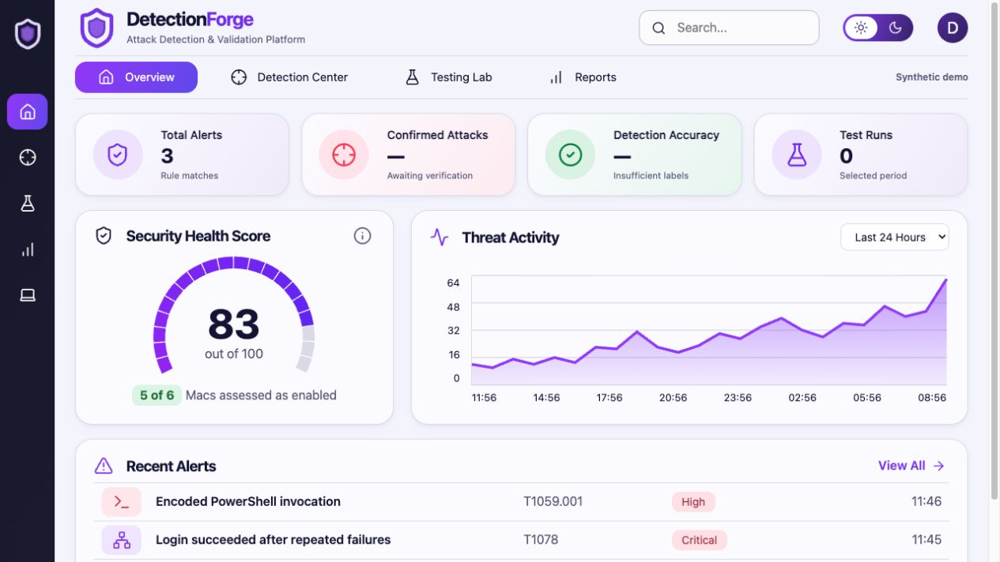
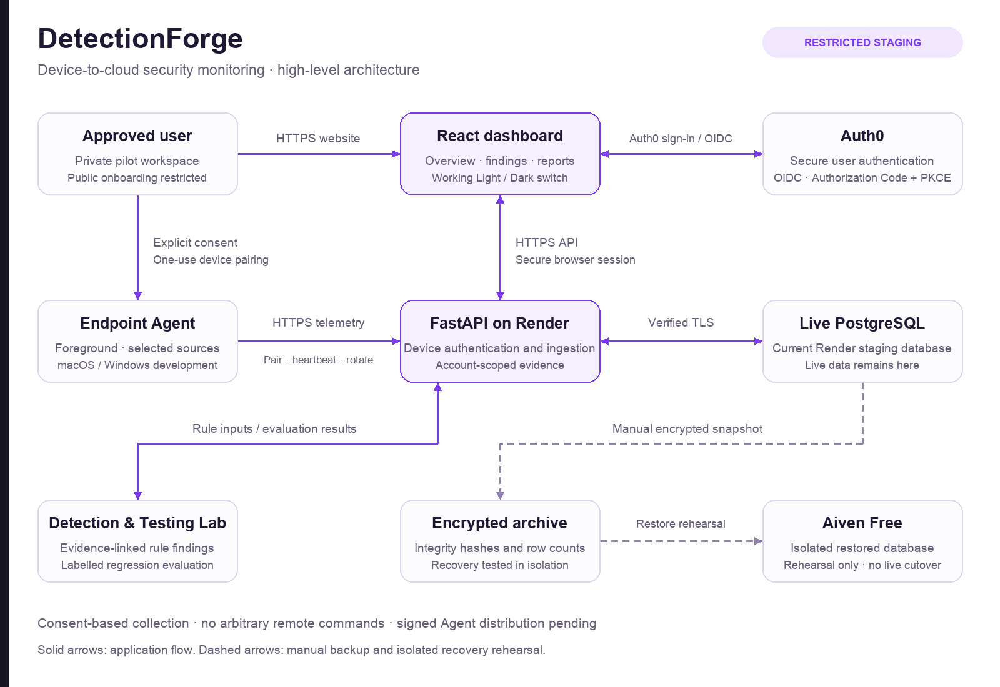
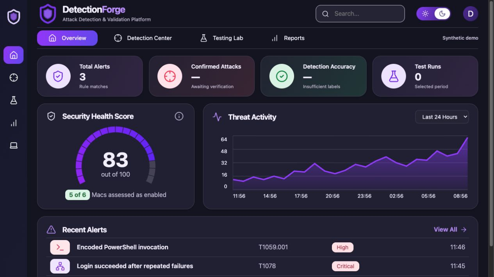
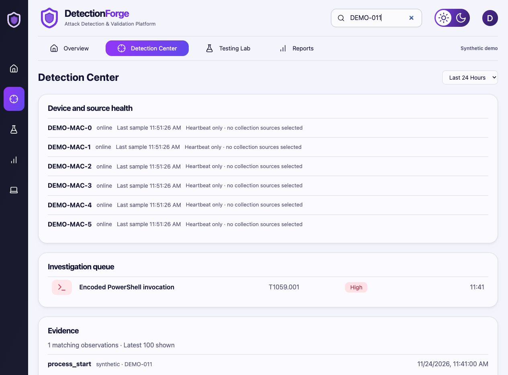
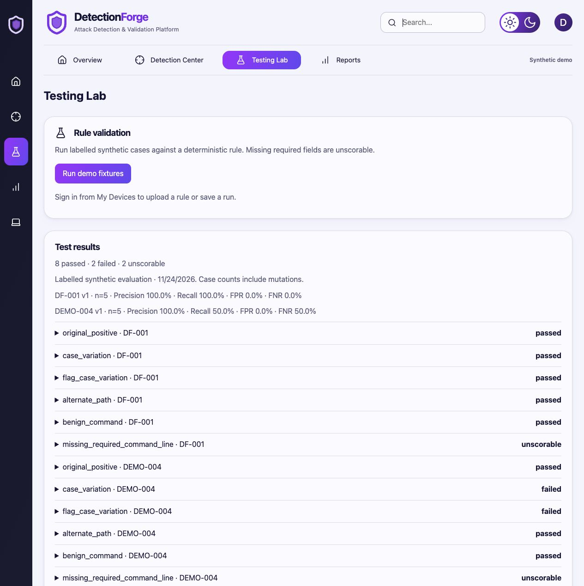

# 🛡️ DetectionForge

**Cloud-Based Security Monitoring & Detection Validation Platform**

DetectionForge connects consented endpoint telemetry to a cloud dashboard for security investigation, evidence-linked findings, and detection-rule validation.

🌐 [Live website](https://detectionforge-pilot.onrender.com) · **Restricted Staging — Verified Engineering Pilot**

This public repository is a portfolio showcase containing documentation, architecture illustrations, and reviewed demonstration screenshots. Application source and its development history remain in a separate private repository.

## Dashboard

The approved interface uses a slim dark sidebar, a clean white-and-purple workspace, and a working Light/Dark switch. Signed-in metrics come from backend records. The screenshots here show **Synthetic demo** fixtures; their scores and alert counts are not claims about real protected devices or attack-detection accuracy.

## Architecture & Flow

[Scalable SVG diagram](assets/architecture-flow.svg)

1. An approved user signs in through Auth0 and opens their private workspace.
2. The user explicitly selects collection sources, starts the foreground Agent, and pairs their device with a one-use code.
3. FastAPI authenticates the device, validates consented telemetry, and stores account-scoped evidence in PostgreSQL over verified TLS.
4. Detection Center links possible findings to evidence. Testing Lab evaluates bounded rules against labelled cases, and the dashboard presents results and reports.
5. Encrypted archives support recovery verification in an isolated database. Aiven Free restore and Render-to-Aiven connectivity were rehearsed successfully; the live database remains on Render pending separate cutover approval.

The architecture image is a high-level overview. It omits private infrastructure identifiers, credentials, source implementation and operational access details.

## Key Features

| Area | Implemented capability |
| --- | --- |
| Security Dashboard | Device connectivity and freshness, evidence counts, activity charts, reports, Light/Dark mode |
| Endpoint Agents | Explicit-consent foreground macOS collection; Windows development support |
| Detection Center | Rule-based possible findings with supporting evidence and audited review decisions |
| Testing Lab | Declarative rule evaluation, labelled regression cases, versioned rules and saved authenticated runs |
| Authentication | Auth0 OIDC, secure browser sessions, one-use device enrollment and account isolation |
| Database recovery | PostgreSQL, encrypted archives, per-table integrity checks and verified isolated restoration |

## Screenshots

### Dark dashboard

### Detection Center

### Testing Lab

The lab screenshot includes deliberately limited demo rules that expose missed cases and unscorable inputs. These are **synthetic rule-evaluation outcomes**, separate from the automated engineering test suite, and do not establish population-wide security accuracy. Screenshot provenance is documented in [assets/SOURCES.md](assets/SOURCES.md).

## Tech Stack

| Frontend | Backend | Storage | Cloud & Security |
| --- | --- | --- | --- |
| React, TypeScript, Vite | Python, FastAPI | PostgreSQL, SQLite for local development | Render, Auth0, Docker, GitHub Actions |

## Engineering & Verification

- Automated coverage includes SQLite/PostgreSQL parity, authorization and tenant isolation, enrollment, device credential lifecycle, browser behavior, container startup and native Windows Agent checks.
- The verified Aiven rehearsal CI run recorded **60 SQLite tests passed (4 skipped)**, **62 PostgreSQL tests passed (2 skipped)**, **6 Windows Agent tests passed**, and **four successful CI jobs**. These are results from that dated rehearsal build, not a claim that every release has the same test count.
- A real managed Aiven restore verified **14 tables**, row counts, integrity fingerprints, and archived identity/device associations.
- A real Render-to-Aiven read-only SQL probe passed with hostname-verified TLS, without switching the live application database.
- Real consented macOS telemetry previously reached the HTTPS pilot in an authorized single-Mac test. Independent second-physical-Mac acceptance remains pending.

No private test logs, database exports, identity mappings, enrollment codes, device tokens, signing keys or cloud credentials are published here. Public verification summaries describe completed checks; the underlying source and detailed engineering evidence remain private.

## Development Journey

- **v0.2:** Device pairing and endpoint connectivity.
- **v0.3:** Full-stack dashboard, authentication, and detection testing.
- **v0.4:** Live HTTPS deployment and real macOS telemetry verification.
- **v0.5:** Security hardening, Agent verification, and encrypted recovery.
- **v0.5.1:** Release-readiness improvements and real Aiven PostgreSQL migration rehearsal.

See [DEVELOPMENT.md](DEVELOPMENT.md) for milestones and evidence boundaries. The original source commit history is preserved privately; this showcase has its own independent Git history.

## Current Status

The live website is an account-restricted engineering pilot. It is not presented as a production-ready security product.

- Public onboarding and hosted signed Agent distribution remain blocked.
- Apple Developer ID signing, notarization and independent physical Mac acceptance are pending. Intel requires separate physical validation.
- The Aiven rehearsal passed; live database migration has not been approved or performed.
- Scheduled encrypted off-site backups, failure-alert delivery and independent production security review remain pending.
- Advanced AI Agents, autonomous learning and Operations Research are outside the current milestone.

**Built to explore secure endpoint monitoring, detection engineering, and reliable cloud infrastructure.**

Project owner: [faresfadly1](https://github.com/faresfadly1).
